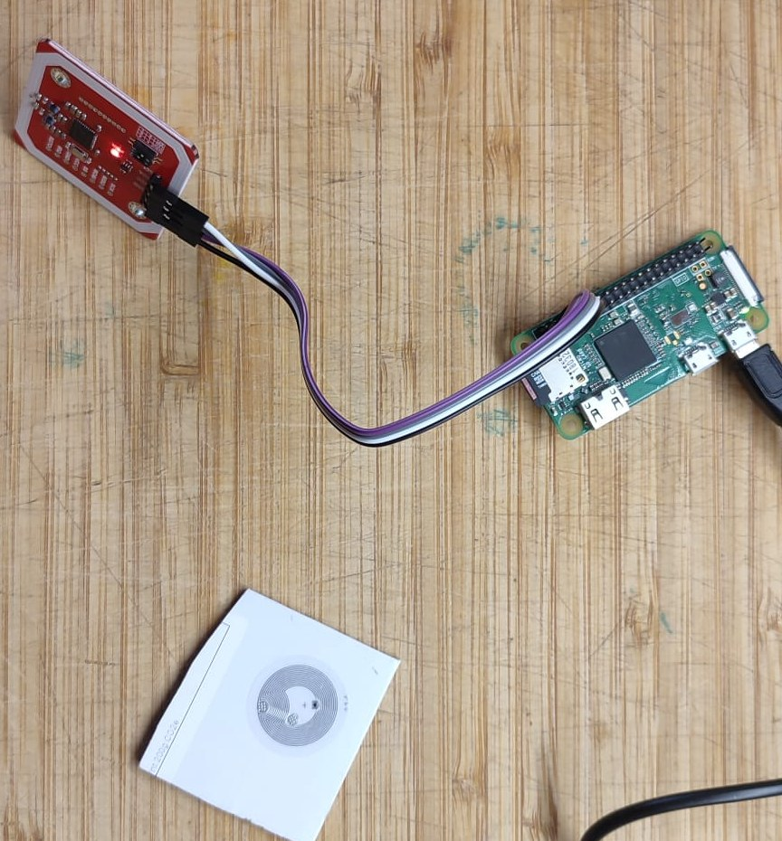

# tapdeck

**Tap an NFC tag, hear an album.** A Raspberry Pi Zero W with an NFC reader under a
piece of plywood. Put a tag on it and the album for that tag plays on a Google /
Chromecast speaker. Lift the tag and the music pauses. Put it back and it carries
on where it left off.



> ⚠️ **This is a proof of concept, not a polished product.** It works on my setup
> and has been tested with a real speaker. Expect rough edges, hard-coded
> assumptions (user `pi`, paths under `/home/pi`) and no tests. Issues and ideas
> are welcome, but treat it as a starting point.

## Hardware

| Part | Notes |
|---|---|
| Raspberry Pi Zero W | Running Raspberry Pi OS 13 (trixie). Any Pi with Wi-Fi and I2C should work. |
| PN532 NFC module (red board) | Set to I2C mode with the DIP switches: **switch 1 ON, switch 2 OFF**. |
| 4 × female-to-female jumper wires | For the PN532's I2C header. |
| NFC tags | NTAG21x stickers and MIFARE Classic 1K cards both work. |
| A Chromecast / Google Home / Nest speaker | Must be on the same network as the Pi. |
| 5 mm plywood (optional) | The reader works through it fine. |

### Wiring (PN532 → Pi GPIO header)

| PN532 | Pi pin | Function |
|---|---|---|
| GND | 6 | Ground |
| VCC | 1 | **3.3 V** (not 5 V) |
| SDA | 3 | GPIO2 / SDA1 |
| SCL | 5 | GPIO3 / SCL1 |

`i2cdetect -y 1` should show the reader at **0x24**.

## How it works

```
 tag on reader ──► PN532 (I2C) ──► nfc_reader.py ──► nfc_player.py ──► Cast speaker
                                     poll + read       picks album        fetches MP3s
                                     NDEF JSON         from ~/music       over HTTP
                                                                          from the Pi
```

1. **Tags carry JSON** in an NDEF Text record (write it with any NFC phone app,
   e.g. NFC Tools). The first field is an album id:
   ```json
   { "id": 1, "anything else": "is ignored" }
   ```
2. **Albums are folders** in `~/music` whose names start with that number:
   ```
   ~/music/001 - joni mitchell - blue/01 All I Want.mp3 ...
   ```
   Tracks play in **ID3 track-number order**, falling back to the number at the start
   of the filename, then a natural filename sort. So `2` comes before `10`.
3. **The Pi serves the files over HTTP** (port 8765, with Range support for seeking).
   [PyChromecast](https://github.com/home-assistant-libs/pychromecast) tells the
   speaker to play them one track after another. The speaker streams each track
   itself; the Pi doesn't push audio.
4. **Presence = playback.** The reader checks for the tag about six times a second.
   If the tag hasn't been seen for **10 seconds**, playback pauses. Any single
   detection resets that clock, so a flaky read never interrupts the music.
   - Same tag back: resume from the same point. If the speaker has forgotten the
     paused session, the track is reloaded at the saved position.
   - Different tag: play that album.
   - Same tag after the album has finished: start it again.
5. **A Samba share** (`\\<pi>\music`, guest access) makes it easy to drop albums on
   from another computer. See [`docs/smb.conf.snippet`](docs/smb.conf.snippet).

All speaker work (discovery, connecting, loading, pausing) runs on its own thread,
so a slow or unreachable speaker never stalls tag detection.

## PN532 lessons learned (the hard part)

These took most of the debugging time, so they're written down here:

- **Slow the I2C bus down.** The PN532 uses clock stretching, which the Pi's I2C
  hardware handles badly at the default speed, giving "Did not receive expected ACK"
  errors. Add `dtparam=i2c_arm_baudrate=50000` to `/boot/firmware/config.txt`.
- **The PN532 searches for a card forever by default.** The Python library stops
  waiting after its timeout, but the chip carries on searching, so every later
  command hits a busy reader. Tags "vanish" while still on the reader. The fix is to
  set a finite retry count (`RFConfiguration`, MxRtyPassiveActivation) so each poll
  ends with a definite yes or no.
- **A tag that's just been read ignores the next search.** Switching the RF field
  off for 50 ms (10 ms was too short) and letting it settle for 30 ms resets the tag.
  With that, a tag left on the reader was seen in 98% of checks, with no gaps.
- **Read 16 bytes at a time.** The library's `ntag2xx_read_block` fetches 16 bytes
  and throws 12 away. Reading 4 pages per transaction brought a full tag read down
  to about 0.13 s, quick enough that a hand-held tag doesn't move mid-read.
- **Phone-written MIFARE Classic cards** use the public NFC Forum keys
  (`A0A1A2A3A4A5` for sector 0, `D3F7D3F7D3F7` for data sectors), not `FFFFFFFFFFFF`.
  A failed authentication puts the card to sleep, so re-select it before trying again.

## Setup

```bash
# On the Pi
sudo raspi-config nonint do_i2c 0
echo 'dtparam=i2c_arm_baudrate=50000' | sudo tee -a /boot/firmware/config.txt
sudo apt install -y i2c-tools python3-venv samba
sudo reboot

git clone https://github.com/johnhunt/tapdeck.git ~/tapdeck
cd ~/tapdeck
python3 -m venv venv
venv/bin/pip install -r requirements.txt     # slow on a Pi Zero - be patient
cp player.env.example player.env && nano player.env   # set CAST_NAME at least
mkdir -p ~/music

# Check the reader and a tag (Ctrl+C to stop)
venv/bin/python tools/read_tag.py

# Run at boot
sudo cp tapdeck.service /etc/systemd/system/
sudo systemctl enable --now tapdeck
journalctl -u tapdeck -f
```

For the music share, append [`docs/smb.conf.snippet`](docs/smb.conf.snippet) to
`/etc/samba/smb.conf`, then run `sudo systemctl restart smbd`.

`tools/tune_diag.py` compares reader settings while a tag sits on the reader, if
you need to re-tune for a different tag or a thicker surface.

## Known issues / ideas

- **First play takes about 6–7 s** from tap to sound. Reading the tag is quick
  (about 0.1 s). Most of the time is probably connecting to the speaker and
  launching the Cast media receiver. Keeping the speaker connection open between
  taps should help.
- **Lifting the tag off takes up to 10 s to pause.** That's deliberate, because
  reliability matters more than a fast stop. Change it with `REMOVE_GRACE` in
  `player.env`.
- Tracks are loaded one at a time, so there's a short gap between them. Using the
  Cast queue would make playback gapless and let the Google Home app's skip
  buttons work.
- Tag → album mappings are cached in memory. Restart the service after rewriting
  a tag.
- One speaker, set in config. Choosing the speaker per tag would be easy to add.
- The Samba share is guest/no-password. Only use it on a network you trust.

## Files

| File | What it does |
|---|---|
| `nfc_player.py` | The service: tag presence, album lookup, HTTP file server, Cast control |
| `nfc_reader.py` | PN532 helpers: tuned polling, NTAG/MIFARE Classic NDEF reading, record decoding |
| `tools/read_tag.py` | Print what's on a tag |
| `tools/tune_diag.py` | Measure detection reliability for different reader settings |
| `player.env.example` | Settings (copy to `player.env`) |
| `tapdeck.service` | systemd unit |

MIT licensed - see [LICENSE](LICENSE). Built with help from Claude.
